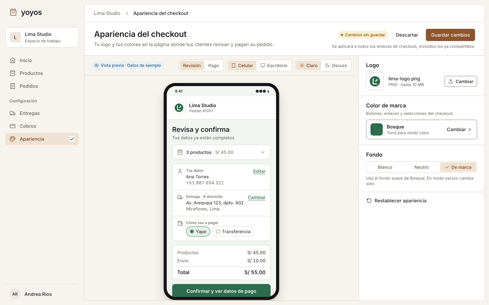
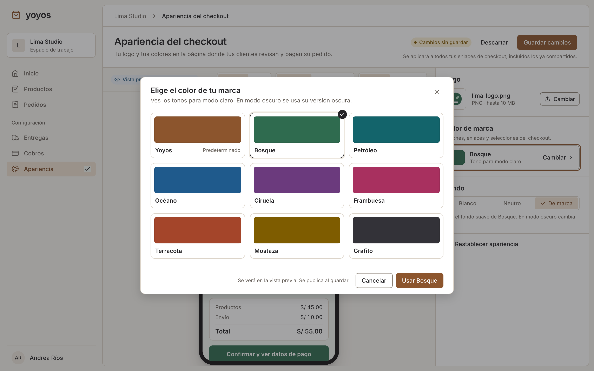

# Apariencia del checkout · Definición de producto

**Estado:** definición lista para implementar. Creado el 8 de octubre de 2026; colores predefinidos el 10 de octubre de 2026; actualizado el 19 de octubre de 2026 con fondos con tono propio y una paleta completa por color (tarea de Todoist 6hpQqCf4X2RX2fr3, decisiones cerradas por el CTO el 19 de octubre de 2026). La primera versión (logo, nueve colores, fondos Blanco/Neutro/De marca, editor y vista previa) ya está construida; este documento describe el diseño vigente con el ajuste incluido. Complementa [Checkout del pedido por link](checkout-por-link.md), cuyas reglas comerciales y de acceso siguen vigentes.

El usuario confirmó avanzar con una personalización limitada a la identidad de marca. Este documento concreta ese alcance y sus reglas de producto.

## Problema y situación

Una tienda de ropa elige Bosque como color de marca y el fondo Blanco. Al abrir su checkout, el comprador ve el botón verde, pero los bordes de las tarjetas, los campos y los separadores siguen en el marrón cálido de Yoyos, y el fondo es blanco puro, igual que el de cualquier otra tienda. El vendedor cambia a Neutro y el fondo pasa a un gris cálido que tampoco tiene que ver con el verde. Solo De marca acompaña al color elegido. El checkout se ve como Yoyos con un botón de otro color, no como la tienda.

## Objetivo

Permitir que cada negocio adapte el checkout a su marca mediante su logo y sus colores, sin conocimientos de diseño ni asistencia técnica, y que el color elegido se note en todo el checkout: fondos, superficies, bordes, campos, acentos y textos secundarios, en claro y en oscuro, sin que ningún elemento quede con un tono de otro color.

El comprador que llega desde redes sociales o WhatsApp debe reconocer al negocio durante la revisión del pedido, la confirmación, la espera de cotización y el pago. El vendedor debe poder configurar esa identidad una vez y revisar el resultado antes de aplicarlo.

La hipótesis de producto es que una identidad reconocible reduce dudas al continuar la compra. No se asume una mejora de conversión hasta medirla.

## Usuarios y superficies

| Usuario | Necesidad | Superficie |
| --- | --- | --- |
| Vendedor con acceso a la configuración de su empresa | Configurar y revisar la apariencia | Configuración → Apariencia del checkout (editor y vista previa) |
| Comprador que recibió el link de su pedido | Reconocer la tienda y completar su pedido | Checkout público `/checkout/:companyId/:orderId`, que incluye el pago |
| Comprador que navega el catálogo público | Reconocer la tienda al elegir productos | [Catálogo público](public-catalog.md): reutiliza logo, color y fondo, pero no la paleta nueva (ver «Catálogo público») |

El editor es web y se adapta a celular y escritorio. El checkout sigue funcionando en el navegador sin cuenta ni instalación. Un editor nativo dentro de la app móvil queda fuera; esta delimitación es una decisión de alcance de la especificación, no una limitación indicada originalmente por el usuario.

La apariencia pertenece a la empresa, no al vendedor ni al pedido. Todos los usuarios que pueden administrar los ajustes de cobro de la empresa administran también su apariencia. No se introduce un sistema nuevo de roles.

## Alcance

| Elemento | Control disponible | Comportamiento |
| --- | --- | --- |
| Logo | Subir, reemplazar y quitar | Se muestra en la cabecera, junto al nombre del negocio, en una ubicación fija. |
| Color de marca | Elegir uno de los nueve colores predefinidos de Yoyos en un diálogo | Define la paleta completa del checkout: acciones, enlaces, selecciones, foco, superficies, bordes, campos y textos secundarios. Cada color trae su paleta para modo claro y oscuro; no se ingresa un valor HEX. |
| Fondo | Suave, Medio o De marca | Tres tonos de fondo de la paleta del color elegido, del más claro al más teñido. Ninguno es blanco puro ni gris neutro. |
| Vista previa | Celular/escritorio y claro/oscuro | Muestra los cambios sin publicarlos ni generar operaciones comerciales. |
| Publicación | Guardar cambios | Aplica el conjunto completo de cambios a la empresa. |
| Restauración | Restablecer apariencia | Prepara la apariencia original de Yoyos (color Yoyos, fondo Medio, sin logo); requiere guardar para publicarla. |

Se mantienen fijos los colores disponibles, la estructura, el layout, los componentes, la tipografía, los tamaños, la posición de elementos, los textos, los campos, la obligatoriedad, las validaciones y el orden del formulario. El ajuste del 19 de octubre de 2026 cambia solo colores: ningún elemento del checkout, del editor ni de la vista previa cambia de lugar, tamaño o forma.

El comprador conserva la capacidad actual de completar o corregir sus datos antes de confirmar. La restricción sobre los inputs se refiere a que el vendedor no puede diseñar ni configurar el formulario.

## Fuera de esta versión

- CSS, HTML, scripts, bloques arrastrables, fondos con imágenes, dominios personalizados y configuraciones por pedido.
- Colores libres: HEX, selector de espectro o cuentagotas. Se reconsidera solo si los vendedores no encuentran su color entre los nueve.
- Agregar o quitar colores del catálogo, o cambiar el tratamiento del logo. Ajustar los tonos derivados de cada color sí entra.
- Rediseñar el layout o los componentes del checkout, del editor o de la vista previa.
- Aplicar la paleta nueva fuera del checkout: catálogo público y panel del vendedor. El catálogo se alinea cuando se decida extenderle la paleta (ver «Catálogo público»).
- Borradores persistentes, historial de versiones y edición colaborativa.

## Flujo del vendedor

1. Entra en **Configuración → Apariencia del checkout**.
2. Ve la configuración publicada y una vista previa con datos ficticios claramente identificados.
3. Sube un logo, abre **Color de marca** para elegir un color en el diálogo y selecciona el fondo (**Suave**, **Medio** o **De marca**). Cada cambio actualiza la vista previa sin afectar enlaces públicos.
4. Revisa el resultado. La vista previa inicia en celular y permite alternar escritorio y modo claro/oscuro.
5. Pulsa **Guardar cambios**. La pantalla informa: «Se aplicará a todos tus enlaces de checkout, incluidos los ya compartidos».
6. Al completarse el guardado, ve «Apariencia actualizada». La configuración publicada pasa a ser el nuevo punto de partida del editor.

En escritorio, los controles y la vista previa aparecen uno junto a otro. En celular, se presentan en una columna con acceso claro a **Ver vista previa** y **Volver a editar**, conservando los cambios al alternar.

### Edición y publicación

- Cambiar un control, subir una imagen o restablecer no publica nada por sí solo.
- **Guardar cambios** solo está disponible cuando hay modificaciones válidas y no hay una subida o guardado en curso.
- **Descartar cambios** recupera la última configuración publicada.
- Al salir del editor con cambios sin guardar, se ofrece continuar editando o descartarlos.
- El borrador vive durante la sesión de edición; no hay borradores persistentes ni historial de versiones.
- Un error de subida o guardado conserva los cambios locales y muestra una acción para reintentar. La apariencia pública anterior se mantiene completa.
- El guardado publica logo, color y fondo como una unidad; nunca una mezcla parcial.
- Si dos vendedores editan a la vez, la última publicación completada prevalece. No se incluye edición colaborativa.

## Reglas del logo

- Formatos admitidos: PNG, JPG y WEBP, con el mismo límite que las demás imágenes de Yoyos (10 MB). El mensaje de ayuda recomienda PNG transparente.
- Se comprueba que el archivo sea una imagen válida tanto al seleccionarlo como al recibirlo en el servidor. SVG queda fuera de esta versión.
- Se conserva la proporción y se muestra la imagen completa. No hay recorte, deformación, posicionamiento libre ni editor de imagen.
- La cabecera reserva un espacio acotado que admite logos cuadrados y horizontales sin desplazar excesivamente el contenido del pedido.
- Se mantiene una superficie blanca detrás del logo en ambos modos para dar estabilidad a la imagen. Es la única superficie del checkout que no toma la paleta del color. No se recolorea ni invierte el archivo.
- El nombre actual de la empresa permanece visible; editar ese nombre no forma parte de este editor.
- Si no hay logo o falla su carga, el nombre identifica al negocio y no aparece un icono de imagen rota.
- Reemplazar o quitar el logo solo afecta a la publicación al guardar. Una subida fallida no elimina el logo publicado.
- La imagen elegida debe pertenecer a la misma empresa. Los logos publicados son visibles para los compradores y el editor debe indicarlo.

## Reglas de color y accesibilidad

El vendedor elige un color de marca de una lista cerrada que define Yoyos. Cada color es una paleta completa ya diseñada y validada por Yoyos para modo claro y oscuro, así que el sistema no calcula ni corrige tonos a partir de un valor del vendedor.

### Colores disponibles

Los nueve colores y su tono principal, que es el que el vendedor ve en la muestra del editor:

| Color | Tono principal claro | Tono principal oscuro | Fondo De marca claro (punto de partida) | Fondo De marca oscuro (punto de partida) |
| --- | --- | --- | --- | --- |
| Yoyos (predeterminado) | `#8C552D` | `#D5A16C` | `#F7EFE6` | `#1F1B19` |
| Bosque | `#2F6B4F` | `#8FCBA8` | `#F1F6F2` | `#181E1B` |
| Petróleo | `#13646B` | `#84CBD0` | `#EEF6F6` | `#161E1F` |
| Océano | `#1F5A8C` | `#8EBDE6` | `#EFF4FA` | `#171C22` |
| Ciruela | `#6B3A7D` | `#C9A2D8` | `#F6F1F8` | `#1E1921` |
| Frambuesa | `#A8305F` | `#EE9BBB` | `#FBF0F4` | `#221A1D` |
| Terracota | `#A4452A` | `#EDA38A` | `#FBF2EE` | `#221B19` |
| Mostaza | `#7E5C00` | `#E3C063` | `#FAF5E6` | `#201E17` |
| Grafito | `#333238` | `#C9C7CF` | `#F4F4F5` | `#1C1C1E` |

- Los tonos principales no cambian. Los demás tonos de cada paleta (incluido el fondo De marca, cuyo valor actual es el punto de partida) los define Yoyos al construir la paleta y pueden ajustarse para cumplir la escala de fondos y los contrastes.
- Los valores HEX son internos de Yoyos: el vendedor ve solo el nombre y la muestra del color, nunca un código ni un campo editable.
- La configuración guarda el identificador del color elegido, no sus tonos. Si Yoyos ajusta los tonos de un color, todas las empresas que lo usan reciben el ajuste al recargar el checkout.
- Un identificador desconocido o retirado se trata como configuración inválida y el checkout usa la apariencia predeterminada (Yoyos con fondo Medio).
- Agregar, modificar o retirar colores es una decisión de producto de Yoyos y se publica como cambio de código, no desde el editor.

### Paleta por color

Cada color define, para modo claro y para modo oscuro, el tono de cada elemento del checkout. Ningún elemento del checkout toma el valor global de Yoyos salvo cuando el color elegido es Yoyos.

| Elemento del checkout | Tono de la paleta |
| --- | --- |
| Fondo de la página | Suave, Medio o De marca, según el fondo elegido |
| Texto principal, de tarjetas y de diálogos | Casi negro en claro y casi blanco en oscuro, con el matiz del color |
| Tarjetas, cabecera, diálogos y menús | En claro, superficie blanca de lectura; en oscuro, una superficie oscura con el matiz del color |
| Zonas atenuadas, filas seleccionables y fondos de secciones secundarias | Tono claro (u oscuro, en modo oscuro) del color, distinto de las tarjetas |
| Texto secundario: ayudas, etiquetas, importes secundarios | Tono intermedio del color |
| Bordes de tarjetas, cabecera y separadores | Tono discreto del color |
| Borde de campos, casillas, radios y controles | Tono más marcado del color que el de los bordes decorativos |
| Foco del teclado | Tono principal del color |
| Acción principal, enlaces y selecciones | Tono principal, con su versión para el puntero encima y para pulsado |
| Texto sobre la acción principal | Blanco en modo claro y casi negro (cercano a `#1C1B1D`) en modo oscuro |
| Realces de selección (fondo y texto) | Tono claro de realce del color con su texto en el tono principal o uno más oscuro |
| Fondo De marca | El tono más teñido de la escala de fondos |

- Todas las paletas se construyen con el mismo criterio: los mismos elementos, la misma posición relativa de cada tono dentro de la escala del color (del fondo más claro al tono principal) y los mismos contrastes mínimos. Ninguna paleta tiene elementos que otra no tenga.
- La paleta Yoyos conserva los valores globales actuales de Yoyos (Caramelo sobrio), incluidos el borde `#DCD4C9` en claro y `#484249` en oscuro, para que las empresas con la apariencia predeterminada no vean cambios fuera de los fondos Suave y De marca.
- Los colores semánticos no pertenecen a la paleta del comercio: errores, advertencias, éxito, información, estados de pago y acciones destructivas mantienen sus significados y colores de Yoyos con cualquier color elegido. El color comercial no redefine «pagado» o «cancelado».
- Los QR, comprobantes e imágenes de instrucciones de pago se muestran con sus colores originales.

### Fondos

Los tres fondos salen de la paleta del color elegido y forman una escala, del más sobrio al más teñido:

| Fondo | Modo claro | Modo oscuro |
| --- | --- | --- |
| **Suave** | El tono más claro de la paleta: casi blanco, con el matiz del color | El oscuro más sobrio de la escala, con un matiz apenas perceptible |
| **Medio** | Un tono claro intermedio de la paleta | Un oscuro intermedio de la escala |
| **De marca** | El fondo más cargado de color de la paleta | El oscuro más teñido de la escala |

- Ningún fondo es blanco puro (`#FFFFFF`) ni gris neutro: los tres llevan el matiz del color elegido.
- Puestos uno al lado del otro con el mismo color, los tres fondos se distinguen a simple vista, en claro y en oscuro.
- Las tarjetas se distinguen del fondo en los tres casos: por su superficie y por su borde.
- El modo oscuro sigue la preferencia actual del producto/navegador. Elegir Suave no desactiva el modo oscuro.
- El vendedor elige un solo color y un solo fondo; no configura por separado los tonos claro y oscuro. La vista previa permite revisar las variantes que realmente verá el comprador.
- Ejemplo: con Bosque y Suave, el comprador ve un fondo casi blanco verdoso, tarjetas blancas con bordes verde grisáceo, campos con borde verde más marcado y el botón `#2F6B4F`. Con Bosque y De marca, el mismo checkout sobre un fondo verde claro más notorio.

### Contraste

Se cumple en modo claro y oscuro, en las 27 combinaciones de color (9) y fondo (3), es decir, 54 variantes:

| Qué | Sobre qué | Mínimo |
| --- | --- | --- |
| Texto principal y texto secundario | Los tres fondos, las tarjetas y las zonas atenuadas | 4,5:1 |
| Texto sobre la acción principal | La acción principal en reposo, con el puntero encima y pulsada | 4,5:1 |
| Enlaces y textos en el color de marca | Fondo, tarjetas y realce de selección | 4,5:1 |
| Texto de los realces de selección | Su fondo de realce | 4,5:1 |
| Borde de campos, casillas, radios y controles | Las tarjetas y el fondo sobre el que aparecen | 3:1 |
| Foco del teclado | Las tarjetas y el fondo sobre el que aparece | 3:1 |

- Los bordes decorativos (tarjetas, cabecera, separadores) no necesitan 3:1, porque no son necesarios para operar; sí deben verse sobre los tres fondos.
- La comprobación es automática y recorre todas las combinaciones. Un color nuevo o un ajuste de tonos debe pasarla antes de publicarse.
- La selección, los errores y los estados no se comunican únicamente mediante color. Se conservan texto, iconos y foco de teclado visibles.

### Selector de color

- En el inspector, **Color de marca** muestra una fila con una sola muestra, el nombre del color y **Cambiar**. La muestra corresponde al tono principal del modo activo en la vista previa, con el texto «Tono para modo claro» o «Tono para modo oscuro».
- Al pulsar la fila se abre el diálogo **Elige el color de tu marca**, con los nueve colores en una cuadrícula. Cada opción muestra una sola muestra del modo activo y su nombre; Yoyos lleva la etiqueta «Predeterminado».
- La opción actual se marca con borde y un icono de verificación, no solo con color. El diálogo indica qué modo se está viendo y que el otro modo usa la versión correspondiente.
- **Usar <color>** aplica la elección al borrador y a la vista previa; **Cancelar**, cerrar o Escape descartan la elección dentro del diálogo. El pie recuerda: «Se verá en la vista previa. Se publica al guardar».
- El diálogo se opera con teclado: foco inicial en la opción actual, flechas para moverse por la cuadrícula, Enter para elegir y devolución del foco a la fila al cerrar.
- El editor y el diálogo usan la identidad de Yoyos (caramelo), no la paleta del color elegido. La paleta solo se ve en la vista previa y en las muestras.

### Selector de fondo

- **Fondo** es el mismo control segmentado de tres opciones de hoy, con los nombres **Suave**, **Medio** y **De marca** (en portugués, **Suave**, **Médio** y **Da marca**). La opción elegida lleva el icono de verificación.
- Debajo del control, una línea de ayuda nombra el color elegido para la opción activa:
  - Suave: «Usa el fondo más claro de {color}. En modo oscuro cambia solo».
  - Medio: «Usa un fondo claro de {color}. En modo oscuro cambia solo».
  - De marca: «Usa el fondo con más color de {color}. En modo oscuro cambia solo».
- Ejemplo: con Bosque y Medio, la línea dice «Usa un fondo claro de Bosque. En modo oscuro cambia solo».

## Experiencia del comprador

La identidad se aplica a `/checkout/:companyId/:orderId`, siempre después de resolver y autorizar el acceso al pedido. El pago ocurre solo dentro del checkout; el antiguo enlace `/pago/:orderId` ya no existe ([retirada del enlace de pago](retirada-enlace-pago-legacy.md)).

| Estado | Resultado esperado |
| --- | --- |
| Pendiente de confirmación | Logo, nombre y paleta en revisión, formulario y acción principal. |
| Confirmado, esperando cotización | Misma identidad; se conservan espera, actualización de estado y bloqueo del pago. |
| Listo para pagar | Misma identidad en selección de medio, instrucciones y carga del comprobante. |
| Comprobante enviado | Misma identidad y mensaje de pago pendiente de revisión. |
| Pagado | Misma identidad con el estado real del pedido. |
| Cancelado | Misma identidad cuando el acceso es válido; confirmación bloqueada. |
| Enlace inválido o no disponible | Error genérico de Yoyos, sin revelar la identidad de una empresa que no se haya podido autorizar. |

Los enlaces ya compartidos conservan su URL. Al abrir o recargar una página, el comprador recibe la última apariencia publicada. Una página que ya está abierta no tiene que cambiar en vivo ni interrumpir la edición del comprador.

Los pedidos históricos usan también la apariencia vigente: no se conserva una copia de la marca por pedido. Los importes, datos del comprador y estados comerciales no se alteran al publicar una apariencia.

## Vista previa

- Usa datos de ejemplo y se identifica como **Vista previa · Datos de ejemplo**. En el estado de pago muestra los medios de pago reales del negocio, o ejemplos si no tiene ninguno; pedido, comprador e importes son siempre ficticios.
- Reproduce el mismo resultado visual que la página pública, incluidos logo, paleta completa, fondos y estados de interacción.
- Permite alternar al menos **Revisión del pedido** y **Pago** para comprobar las dos superficies principales del recorrido.
- No utiliza información real de compradores ni enlaces públicos de pedidos como material de prueba.
- Los botones de confirmación, pago y carga de comprobantes son demostrativos: no envían solicitudes, crean pedidos ni registran pagos.
- Un logo nuevo puede previsualizarse antes del guardado, pero no se considera publicado por haber sido subido.

## Catálogo público

El [catálogo público](public-catalog.md) muestra el logo, el nombre y la apariencia del negocio para que catálogo y checkout se reconozcan como la misma tienda. La paleta nueva no se aplica al catálogo: el catálogo se sigue viendo exactamente como hoy.

| Aspecto | Comportamiento en el catálogo |
| --- | --- |
| Logo y nombre | Como hoy, con la misma configuración del editor. |
| Color de marca | Los tonos que usa hoy (acción principal y sus estados, foco, realce y fondo De marca), con los valores vigentes antes de este ajuste. Un ajuste de tonos hecho para la paleta del checkout no llega al catálogo. |
| Bordes, tarjetas, campos y textos | Los valores globales de Yoyos, como hoy. |
| Fondo Suave | Se ve como el antiguo Blanco: blanco en claro y el oscuro neutro de Yoyos en oscuro. |
| Fondo Medio | Se ve como el antiguo Neutro: la base neutra de Yoyos en claro y en oscuro. |
| Fondo De marca | Como hoy: el fondo De marca vigente antes de este ajuste. |

- El editor no muestra una vista previa del catálogo ni avisa que el catálogo se ve distinto; la vista previa es del checkout.
- Punto de encuentro: si se decide extender la paleta al catálogo, el catálogo pasa a usar la misma paleta y los mismos fondos que el checkout, sin opciones nuevas en el editor.

## Valores iniciales y valores guardados

- Las empresas sin configuración usan la apariencia predeterminada: color Yoyos con fondo Medio y su nombre en la cabecera. No necesitan completar un nuevo paso para seguir compartiendo pedidos.
- Yoyos con Medio en modo claro conserva la base neutra actual de Yoyos (`#F7F4EF`), así que el checkout predeterminado no cambia de fondo en claro.
- Las empresas que tenían guardado **Blanco** pasan a **Suave** y las que tenían **Neutro** pasan a **Medio**, sin intervención del vendedor y sin aviso. **De marca** se mantiene. Al abrir el editor ven la opción nueva seleccionada; al abrir su checkout, el comprador ve el fondo nuevo con el matiz del color.
- Ningún registro guardado queda inválido: toda configuración que funcionaba antes del ajuste sigue funcionando y se muestra con su opción equivalente.
- Ejemplo: «Moda Lucía» tenía Ciruela con Blanco. Tras el ajuste, su editor muestra Ciruela con Suave seleccionado y su checkout tiene un fondo casi blanco con matiz ciruela y bordes ciruela; su catálogo sigue con el fondo blanco de antes.
- **Restablecer apariencia** deja sin logo personalizado y recupera en el borrador el color Yoyos y el fondo Medio. Se puede deshacer descartando; solo se aplica a compradores después de guardar.
- Una configuración de apariencia ausente o inválida no impide confirmar ni pagar un pedido válido: se utiliza la apariencia predeterminada. Esto no sustituye ni omite las validaciones de acceso, importes, entrega o pago.

## Cuando algo falla

| Situación | Qué ve el usuario | Qué puede hacer |
| --- | --- | --- |
| Falla la subida del logo | «No pudimos subir el logo. Inténtalo de nuevo.» El borrador y lo publicado se conservan | Reintentar |
| Falla el guardado | «No pudimos guardar la apariencia. Conservamos tu borrador.» La apariencia pública anterior sigue completa | **Reintentar** |
| El servidor rechaza el color o el fondo | «Revisa el color y el fondo e inténtalo de nuevo.» El borrador se conserva | Elegir de nuevo y guardar |
| No carga la configuración en el editor | «No se pudo cargar la apariencia» | Reintentar más tarde |
| El checkout recibe una apariencia ausente o inválida | El comprador ve la apariencia predeterminada; el pedido sigue operando | Nada |
| Falla la carga del logo en el checkout | El nombre del negocio identifica a la tienda, sin imagen rota | Nada |

## Límites de seguridad y comportamiento comercial

- Solo usuarios autenticados con acceso a la configuración de la empresa pueden modificar su apariencia. Conocer un enlace público no concede ese permiso.
- La empresa se determina desde el contexto autorizado; un usuario no puede modificar otra empresa ni asociar sus imágenes.
- La respuesta pública expone únicamente los datos visuales necesarios, sin configuración privada ni información de administración.
- Los tonos salen solo del catálogo de colores de Yoyos; ningún dato del vendedor llega como color o estilo.
- Se conservan las reglas de privacidad y caché de las páginas públicas existentes.
- Confirmar sigue expresando intención de compra; no significa pago recibido. La revisión del vendedor sigue siendo necesaria para confirmar el cobro.
- No cambian los campos, validaciones, cálculo de totales, cotización de entrega, requisitos del comprobante ni disponibilidad de medios de pago.
- La personalización no cambia el tema del panel de gestión.

## Vocabulario

- Color de marca: uno de los nueve colores de Yoyos, «Color de marca» en el editor. Cada uno trae su paleta.
- Paleta: el conjunto de tonos de un color de marca para cada elemento del checkout, en claro y en oscuro. No es visible como tal para el vendedor.
- Fondo: «Suave», «Medio» o «De marca», los tres tonos de fondo de la paleta del color elegido.

## Decisiones cerradas

| Decisión | Por qué |
| --- | --- |
| Tres fondos, Suave, Medio y De marca, todos de la paleta del color elegido; en oscuro, la misma escala de lo más sobrio a lo más teñido | Que el fondo acompañe al color; ninguno queda gris o blanco puro (CTO, 19/10/2026) |
| Blanco pasa a Suave y Neutro pasa a Medio, sin intervención del vendedor, sin registros inválidos | El checkout de nadie se rompe (CTO, 19/10/2026) |
| Apariencia predeterminada: Yoyos con Medio | Equivale al Neutro anterior (CTO, 19/10/2026) |
| Cada color define todos los elementos del checkout, incluidos bordes y campos, con el mismo criterio para las nueve paletas | Que el color se note de punta a punta y nada quede desentonado (CTO, 19/10/2026) |
| Textos ≥ 4,5:1; bordes de campos, controles y foco ≥ 3:1; en claro y oscuro y en las 27 combinaciones | Legibilidad WCAG AA con cualquier elección (CTO, 19/10/2026) |
| La paleta se aplica al checkout del comprador y a la vista previa del editor; no al panel ni al catálogo público | Acotar el cambio al checkout (CTO, 19/10/2026) |
| El catálogo público se sigue viendo exactamente como antes del ajuste | Consecuencia de la decisión anterior: el catálogo no cambia hasta que se decida extenderle la paleta |
| Colores cerrados de Yoyos, sin HEX libre | Garantiza contraste y coherencia sin que el vendedor sepa de diseño |
| Solo cambian los colores; layout y componentes se mantienen | El ajuste es de apariencia, no un rediseño |
| Colores semánticos y superficie del logo fuera de la paleta | «Pagado», «cancelado» y los errores significan lo mismo en todas las tiendas; el logo necesita una superficie estable |

## Criterios de aceptación

1. Una empresa sin personalización ve su checkout con Yoyos y fondo Medio; en modo claro el fondo es `#F7F4EF` y bordes, campos y textos tienen los mismos colores que antes del ajuste.
2. Un vendedor autorizado puede subir, reemplazar y quitar un logo admitido; un archivo inválido o demasiado grande produce un error comprensible y conserva la publicación anterior.
3. Un logo cuadrado, horizontal o transparente se muestra completo en celular y escritorio sobre su superficie blanca; si falla, el nombre del negocio sigue visible.
4. El vendedor cambia de Yoyos a Océano en el editor: en la vista previa, en claro y en oscuro, cambian el fondo, los bordes de tarjetas, cabecera y separadores, los bordes de campos, el foco, las zonas atenuadas, los textos secundarios y los botones. Ningún borde queda en `#DCD4C9` ni en `#484249`. Las páginas públicas no cambian hasta guardar.
5. Tras guardar Océano con Medio, un enlace de checkout ya compartido, al recargarse, muestra los mismos colores que la vista previa en revisión, espera de cotización, pago, comprobante enviado, pagado y cancelado, manteniendo su URL.
6. El control de fondo muestra «Suave», «Medio» y «De marca». Con Terracota, las tres opciones dan tres fondos distintos a simple vista, con matiz terracota, ninguno `#FFFFFF` ni gris neutro, en claro y en oscuro.
7. Con Bosque y Medio, la línea de ayuda dice «Usa un fondo claro de Bosque. En modo oscuro cambia solo».
8. Una comprobación automática recorre los nueve colores con los tres fondos, en claro y oscuro, y confirma que textos principal y secundario, texto del botón en sus tres estados, enlaces y realces alcanzan 4,5:1, y que bordes de campos, controles y foco alcanzan 3:1 sobre tarjeta y fondo. Si un tono no cumple, la comprobación falla y nombra color, fondo, modo y elemento.
9. Con cualquiera de los nueve colores, cada elemento del checkout usa un tono de la paleta de ese color; ninguno toma un tono de otro color ni el marrón predeterminado, salvo con Yoyos. Las excepciones son los colores semánticos, la superficie del logo y las imágenes de pago.
10. Se revisó visualmente el checkout con los nueve colores y los tres fondos, en claro y oscuro, comparándolos lado a lado, y cada uno se ve coherente con su paleta.
11. Una empresa que tenía Ciruela con Blanco abre su editor y ve Ciruela con «Suave» seleccionado; su checkout carga sin errores con el fondo Suave de Ciruela. Una que tenía Neutro ve «Medio». Ninguna tuvo que hacer nada.
12. **Restablecer apariencia** deja en el borrador Yoyos con «Medio» y sin logo; solo se publica al guardar.
13. Un identificador de color desconocido muestra la apariencia predeterminada sin bloquear el pedido.
14. Con Bosque y Suave guardados, el catálogo público de esa empresa se ve igual que antes del ajuste: fondo blanco en claro, bordes y tarjetas con los colores globales de Yoyos y los botones en `#2F6B4F`.
15. Entre antes y después del ajuste, ningún elemento del checkout, del editor ni de la vista previa cambia de posición, tamaño o forma; solo cambian colores.
16. Una subida o publicación fallida permite reintentar sin perder la edición ni alterar parcialmente la apariencia pública. Descartar recupera lo publicado; salir con cambios pendientes ofrece conservar la edición o descartarla.
17. La vista previa usa datos ficticios y ninguna interacción ejecuta acciones comerciales reales.
18. La configuración de una empresa no modifica la de otra ni la apariencia del panel privado; un comprador no puede editarla.
19. Los formularios y las reglas comerciales existentes conservan su funcionamiento, incluido el bloqueo del pago mientras falta cotizar la entrega.
20. Un enlace no autorizado muestra el error genérico; un fallo exclusivo del logo o de la apariencia no bloquea un pedido autorizado.
21. La pantalla de configuración y la experiencia pública pueden operarse con teclado y en una pantalla de celular sin desplazamiento horizontal causado por los controles o el logo.

## Diseño web elegido · Vista previa protagonista con colores predefinidos

El usuario seleccionó **Vista previa protagonista** entre tres propuestas de Impeccable y luego aprobó su versión con colores predefinidos (a4, 10 de octubre de 2026). Es la referencia visual de la pantalla de configuración web, ya construida. El ajuste del 19 de octubre de 2026 solo renombra las opciones del fondo y cambia los colores de la vista previa; no altera esta composición.

- Editor con el diálogo cerrado: [claro](../.impeccable/mocks/checkout-editable/a4-closed-light.png) y [oscuro](../.impeccable/mocks/checkout-editable/a4-closed-dark.png).
- Diálogo de colores: [claro](../.impeccable/mocks/checkout-editable/a4-dialog-light.png) y [oscuro](../.impeccable/mocks/checkout-editable/a4-dialog-dark.png).
- [Registro de aprobación](../.impeccable/mocks/checkout-editable/a4.json) y [fuentes HTML de los mocks](../.impeccable/mocks/checkout-editable/src/), capturados a 1440 × 900.

### Composición que debe conservarse

1. **Navegación existente de Yoyos a la izquierda**, con Apariencia seleccionada dentro de Configuración y sin modificar la identidad del panel de gestión.
2. **Cabecera con título y publicación**: título y descripción a la izquierda; estado de cambios, Descartar y Guardar cambios a la derecha. El alcance de la publicación se comunica junto a las acciones.
3. **Vista previa como región principal**, ocupando aproximadamente dos tercios del espacio de edición. El comprador ve su checkout dentro de un lienzo neutro, separado de los controles administrativos.
4. **Barra sobre la vista previa** con identificación de datos de ejemplo y controles de revisión/pago, dispositivo y modo claro/oscuro.
5. **Inspector fijo a la derecha**, de aproximadamente un tercio del área de edición, con Logo → Color de marca → Fondo → Restablecer apariencia. Secciones separadas por líneas discretas, sin convertirlas en un asistente de pasos.
6. **Color de marca como fila que abre un diálogo**: una sola muestra del modo activo, nombre del color y Cambiar. No se muestran juntos los tonos claro, oscuro y de fondo.
7. **Fondo como control segmentado** Suave / Medio / De marca, con una línea de ayuda debajo.
8. **Diálogo de colores** con cuadrícula de 3 × 3, una muestra por opción, selección con borde y verificación, y pie con nota de publicación, Cancelar y Usar <color>.
9. **Identidades separadas**: caramelo para acciones y selección del editor; paleta del comercio en la vista previa y las muestras de color. Bosque, el verde de Lima Studio, es un ejemplo, no el valor predeterminado del producto.

### Directrices de implementación de Impeccable

- Seguir el flujo **comp-led**: el mock elegido gobierna composición, proporciones, jerarquía, densidad y carácter de los componentes. No sustituirlo por otra distribución conservando solo los colores.
- Mantener el sistema visual existente, **Caramelo sobrio**, la tipografía Inter, superficies planas y bordes discretos. Esta pantalla amplía Yoyos; no establece una identidad global nueva.
- Construir textos, controles y vista previa con componentes semánticos. La imagen aprobada es una referencia, nunca un fondo que sustituya la interfaz funcional.
- La vista previa debe reutilizar el resultado visual del checkout real. La imagen no autoriza introducir campos, afirmaciones de seguridad, cambios comerciales ni un checkout diferente al definido en este documento.
- Tienda, monograma, comprador, dirección e importes del mock son datos ficticios. Los colores del producto son los de la paleta de cada color, no los que se midan en la imagen.
- El marco móvil representa el dispositivo previsualizado; no implica una app nativa ni nuevos controles del comprador.
- Verificar celular y escritorio, claro y oscuro, teclado, errores y guardado. Comparar tanto la vista previa como la página pública para evitar divergencias.
- Al terminar el ajuste de paletas, revisar con Impeccable los nueve colores con los tres fondos en claro y oscuro, resolver sus hallazgos materiales y actualizar el registro de superficie con evidencia del resultado construido.

## Validación de producto

Probar con 3–5 vendedores usando logos y colores reales. Observar si encuentran la configuración, completan la personalización sin ayuda, entienden cuándo se publica y a qué enlaces afecta, y si reconocen la diferencia entre Suave, Medio y De marca.

Medir adopción entre negocios que usan checkout, finalización del flujo de configuración, distribución de fondos elegidos y frecuencia de errores de subida/guardado. Comparar el avance de apertura a confirmación y de pago habilitado a comprobante enviado, separando pedidos que esperan cotización para no atribuir esa espera al diseño.

Las métricas son una propuesta de evaluación, no funcionalidades adicionales del editor ni una promesa de mejora comercial. Los objetivos numéricos se fijarán con una línea base; no condicionan la definición funcional.

## Referencias y puntos de partida

- [Checkout por link de Yoyos](checkout-por-link.md): reglas del pedido, acceso público, entrega y pago.
- [Catálogo público](public-catalog.md): reutiliza logo, color y fondo sin la paleta nueva.
- [Página de checkout](../apps/core/app/routes/checkout.tsx): superficie que recibe la identidad.
- [Ajustes de cobro](../apps/core/app/routes/payment-settings.tsx): patrón existente de configuración y carga de imágenes.
- [Tokens de diseño](design-tokens.json): valores globales de Yoyos, que son la paleta del color Yoyos.
- [Stripe: apariencia de Checkout](https://docs.stripe.com/payments/checkout/customization/appearance?payment-ui=stripe-hosted): referencia de controles acotados de marca.
- [Shopify: estilo del checkout](https://help.shopify.com/en/manual/checkout-settings/customize-checkout-configurations/checkout-style): referencia de configuración visual.
- [W3C: contraste de texto](https://www.w3.org/WAI/WCAG22/Understanding/contrast-minimum.html) y [contraste no textual](https://www.w3.org/WAI/WCAG22/Understanding/non-text-contrast.html).

Este documento define comportamiento de producto y la dirección visual del editor web. Si los identificadores internos de los fondos se renombran o se conservan con nombres nuevos en pantalla se resuelve en implementación, siguiendo el skill de arquitectura; en los dos casos ningún registro existente queda inválido. La separación entre la paleta del checkout y los tonos que conserva el catálogo también se resuelve en implementación.
