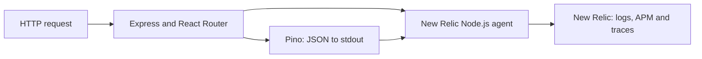

# Logging and observability

Logs explain what happened and give enough safe context to investigate a request
or failure without recording private data. This applies to the `apps/core`
server (Express and React Router). The New Relic Node.js agent is not loaded in
the Expo app; mobile has no shared logging strategy.

## Architecture

| Decision | Reason |
| --- | --- |
| Pino is the only application log source, writing JSON to stdout | One structured format for containers and forwarding; no custom transport. |
| The New Relic Node.js agent forwards Pino logs and provides APM and traces | Logs, transactions and traces correlate in one tool. |
| No log table in PostgreSQL | Logs are diagnostics, not business data or an audit trail. |



- [`logger.ts`](../apps/core/src/shared/infrastructure/logger.ts) configures the
  single logger. The level defaults to `info` and is changed with `LOG_LEVEL`.
  Pino `redact` covers known secret paths as a fallback only.
- Each request gets a validated or generated `requestId`, returned in the
  `x-request-id` header for API and React Router responses. `log` adds it to every
  event; access middleware adds `companyId` once the company is selected. Request
  completion logs method, normalized route, status and `durationMs`.
- The agent's privacy rules live in [`newrelic.cjs`](../apps/core/newrelic.cjs):
  they exclude request URLs, parameters and headers, order UUIDs and response
  headers, and strip exception messages. `apm-privacy.test.ts` checks them.

## Running

- `pnpm --dir apps/core start` preloads the agent; `pnpm --dir apps/core dev` runs without it.
- `NEW_RELIC_ENABLED=false` (the default in `start`) runs without a license. To
  enable APM and forwarding set `NEW_RELIC_ENABLED=true`, `NEW_RELIC_LICENSE_KEY`
  and `NEW_RELIC_APP_NAME`. The license is never stored in the repository.
- Never set `NEW_RELIC_NO_CONFIG_FILE=true`: it skips the privacy rules.
- If the infrastructure also forwards stdout to New Relic, set
  `NEW_RELIC_APPLICATION_LOGGING_FORWARDING_ENABLED=false` to avoid duplicates.

## Writing a log

Use the shared logger in core server code with an object followed by a short,
stable English message. Do not use `console.*` or another wrapper. The logger is
server-only; never import it into browser or mobile code.

```ts
import { log } from "@core/src/shared/infrastructure/logger";

log.error({
  event: "unable_to_save_order",
  orderId,
  errorCode: "PERSISTENCE_UNAVAILABLE",
  err: cause,
}, "Unable to save order");
```

### Event name

- A stable English `snake_case` name for the operation and outcome, such as
  `product_create_persistence_failed`. Avoid vague names like `error`.
- Search existing logs first and reuse the event for the same operation; keep
  existing names so searches keep working.
- Variable values go in fields, never in the event name or message.

### Context

Include only what was affected, what explains the outcome and what helps the
investigation. Keep fields flat with consistent types, prefer identifiers over
objects, select fields explicitly (never spread or stringify objects) and omit
unavailable data instead of adding placeholders. Common fields: `requestId`,
`companyId` (only once authenticated), `userId`, `orderId`, `errorCode`,
`durationMs`, `statusCode`.

Never log credentials, tokens, headers, cookies, connection strings, customer
names, emails, phone numbers, message content, payment details, signed URLs,
full URLs with sensitive parameters, or complete request/response bodies.

Pass failures through `err`; the logger sanitizes message and stack. Do not copy
`cause.message`, `cause.stack`, `String(cause)` or provider metadata into other
fields, and do not copy arbitrary external error codes. Use a safe `errorCode`.

### Level

| Level | Use for |
| --- | --- |
| `debug` | Bounded diagnostic detail during an investigation. |
| `info` | Useful completion summaries and process lifecycle events. |
| `warn` | Degraded behavior or a failed attempt that will be retried. |
| `error` | Unexpected operation failures, invalid stored data, or exhausted retries. |
| `fatal` | Unrecoverable failures after which the process terminates. |

### Where

- Expected validation failures, missing records, duplicates and business
  rejections return a `Result` failure without a log.
- Log a technical failure once, where it is handled with useful context: usually
  an infrastructure adapter or the final request/worker boundary. If an adapter
  logs and returns a failed `Result`, its caller does not log it again.
- Keep logging out of pure domain code; do not log every query, loop item or
  successful read, and do not duplicate HTTP completion logs.
- For background work (for example emails sent after the HTTP response), handle
  both rejected promises and failed `Result` values.
- Logs keep `companyId` as diagnostic context only; they do not replace tenant
  isolation and are not a business audit log.

When changing a log path, check its event, level, context, absence of sensitive
data, and that the same failure is not logged twice.
